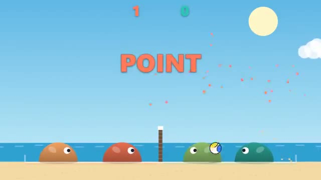

# Slime Volley

Jump, bonk, don't let it touch your sand. A multiplayer starter game from [Multiplayer Agent](https://multiplayeragent.com): 2D, versus, 2–4 players, with bots that fill the empty spots.

## How it plays

Run and jump your slime to bounce the ball over the net. If it lands on your side, the other side scores. First to 7 wins; with 3 or 4 players it's two a side.

**Controls:** A/D or arrows to move, W, ↑ or Space to jump · touch: ◀ ▶ and JUMP buttons.

## Make it yours in the Game Builder

Open the [Game Builder](https://multiplayeragent.com), choose **Start from a starter game** and pick Slime Volley. It opens as version 1 in your studio, ready to play and publish. Then ask for changes, for example:

- Make the net higher and the ball lighter
- Add a power smash when you jump twice
- Make it a snowy mountain with a snowball

## Run it yourself

1. Get a free publishable key (`pk_…`) at [multiplayeragent.com](https://multiplayeragent.com).
2. In `index.html`, put it in place of `pk_REPLACE_ME` in the `MP_CONNECT` block.
3. Open `index.html` in a browser. No build step and no server needed.

Without a key it still runs, offline against a bot.

## How it is built

- One `index.html`. The comment at the top of the script maps the code and explains the multiplayer.
- **Host-run physics:** One player's browser moves the ball and keeps the score, so both sides see the same bounce; if it leaves, the next player takes over. Your own slime's hits are decided on your screen, so a save you see is a save.
- **Bots:** A bot plays the other side until a friend joins, and fills any empty spot in two-a-side.
- **Leaderboard:** Most wins, for every player.
- **Live sync:** Every slime and the ball move for everyone at once.
- `?attract` runs it offline, bots only, two a side. The preview video is recorded from it.

## License

MIT.
